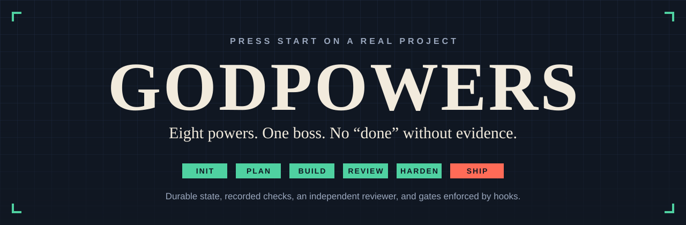
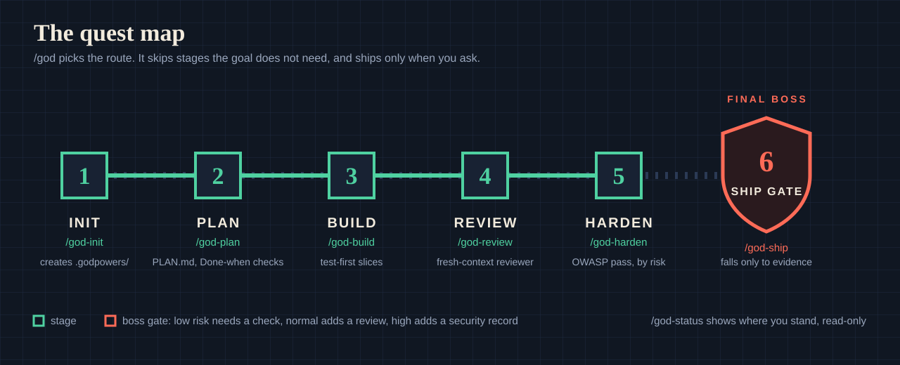

<p align="center">
  
</p>

[](https://www.npmjs.com/package/@hxp-tools/godpowers)
[](https://github.com/hannsxpeter/godpowers/actions/workflows/ci.yml)
[](LICENSE)

Godpowers turns shipping with an AI coding agent into a quest with rules. The
model does the planning and the coding. Godpowers adds the four things a model
cannot do for itself: project memory on disk that survives sessions and tools,
a record of which checks really ran against which code, an independent
reviewer in a fresh context, and gates that code enforces through Claude Code
and Codex hooks. Nothing counts as done until the evidence says so.

It is small on purpose: 8 commands, 4 agents, and about 6K tokens of
instructions in total. About 600 tokens load per session whether you use it or
not.

## Press start

```bash
npx @hxp-tools/godpowers --claude --global
```

Godpowers moved from `godpowers` to `@hxp-tools/godpowers` on npm in 7.3.0; the
old package stops at 6.3.0. The command you run is still `godpowers`.

Then, in your repository, run `/god-init`, and ask `/god` for what you want.
`/god` with no goal tells you where you stand and the next step.

Use `--codex` for Codex, `--claude --codex` for both, or `--all` for every
supported host. Claude Code and Codex get the hooks; Cursor, Windsurf, Gemini
CLI, OpenCode, Copilot, and the other hosts get the skills and agents only.
`--local` installs into the current directory instead of your home directory.
Codex runs new hooks only after you trust them: open `/hooks` once after
installing.

Claude Code can also install Godpowers as a plugin (commands are namespaced,
for example `/godpowers:god`):

```text
/plugin marketplace add hannsxpeter/godpowers
/plugin install godpowers@godpowers
```

Pick one install method per host; installing both runs the hooks twice.
Uninstall with `npx @hxp-tools/godpowers --claude --uninstall`.

## The quest map

<p align="center">
  
</p>

Every project walks the same road: **init, plan, build, review, harden, ship**.
`/god` picks the smallest route that does the job well. A question gets an
answer. A small change gets made and verified. A feature gets built and
independently reviewed. It writes a plan only when your request does not
already list the requirements, adds a security pass only when the change
touches a trust boundary (auth, secrets, untrusted input, money, deleting
data), and ships only when you ask.

## Your powers

| Power | What it does |
| --- | --- |
| `/god` | Front door: the next step, or drive a goal through the stages it needs |
| `/god-init` | Set up `.godpowers/`, detect your check command, or migrate a 6.x project |
| `/god-plan` | Write `PLAN.md`: goal, requirements with "Done when" checks, design, slices |
| `/god-build` | Implement slices test-first and record the checks |
| `/god-review` | Independent review in a fresh context, then fix and record |
| `/god-harden` | OWASP Top 10 pass with dependency and secret checks |
| `/god-ship` | Pass the ship gate, then deploy, verify health, record |
| `/god-status` | State, evidence freshness, and open risks, read-only |

Four optional agents back the powers: `god-planner`, `god-executor`,
`god-reviewer`, and `god-security-auditor`. The skills never require them; the
agent running a skill decides whether to delegate, and passes the model and
reasoning effort explicitly instead of letting a subagent inherit its own.

## Achievements

An achievement is a record in `.godpowers/evidence.jsonl`, and it is earned
only with real evidence. Each record is tied to a fingerprint of the tracked
and untracked files (not ignored files, and not `.godpowers/`). When that
fingerprint differs, the record is stale until you earn it again, and it counts
again if the code returns to the fingerprint it was recorded on.

<p align="center">
  
  
  
  
</p>

| Achievement | Earned by |
| --- | --- |
| Verified | `godpowers verify` runs the check declared in `STATE.md` and it passes |
| Reviewed | `/god-review` records a passing review from a fresh context |
| Hardened | `/god-harden` records a passing security pass |
| Shipped | `/god-ship` passes the ship gate and records the release |

Only Verified is backed by an executed command. Reviewed, Hardened, and
Shipped are attestations the CLI binds to the exact code; see
[Limits](#limits).

## The final boss: the ship gate

`godpowers gate ship` is the boss, and it only falls to recorded evidence. How
much you need depends on the risk of the change since the latest `v*` tag:

| Risk tier | Covers | To pass the gate |
| --- | --- | --- |
| Low | Only documentation and test files changed | A passing check |
| Normal | Everything else | A passing check and a passing review |
| High | Sign-in and authorization, sessions, crypto, secrets, migrations, payments, CI, Docker, Terraform, Kubernetes, deploy folders, or a path matching your `risk:` globs | A passing check, a review, and a security record |

An open critical risk always blocks. With no tag and no `--base` there is
nothing to compare, so the tier is high. Two hooks guard the road before the
boss:

- **Stop hook.** If a session ends a turn after changing code and there is
  neither a passing run of your declared check nor a recorded waiver for the
  current code (a waiver is not a check run), the agent is asked to run
  `godpowers verify` first. The latest record for the current code decides, so a
  later failed check overrides an earlier waiver. Documentation-only changes pass.
- **Commit hook.** `git commit` is blocked while `godpowers lint` finds errors
  in `.godpowers/`, such as a malformed risk line or an edited past decision.

Hooks exist only on Claude Code and Codex. On other hosts the gates are
instructions. A waiver (`godpowers verify --waive "<reason>"`) records that no
automated check covers the code; with `verify: none` in `STATE.md`, a waived
check does not block the ship gate and shows as a warning. The full rules, including how records match code, are in the
[reference](docs/reference.md#gates).

## Your save file

Everything lives in `.godpowers/`, which you commit with your code:

- `STATE.md`: the one state file. Frontmatter holds `project`, `stage`, and
  `verify` (your check command); the body holds Goal, Now, Next, and Risks.
- `PLAN.md`: goal, requirements with "Done when" checks, non-goals, design,
  and slices. Skipped when the request already lists its requirements.
- `DECISIONS.md`: an append-only decision log.
- `evidence.jsonl`: written only by the CLI, chained by digest.

## CLI at a glance

The powers call the CLI for you. You can run it directly too. The quick-start
install does not put `godpowers` on your PATH, so run these as
`npx -y @hxp-tools/godpowers@7 <cmd>`, or install the binary with
`npm install -g @hxp-tools/godpowers`.

```text
godpowers init [--verify "<cmd>"]       set up .godpowers/
godpowers status [--json]               stage, evidence freshness, risks, next step
godpowers verify "<cmd>"                run a check and record it
godpowers record review|harden|ship --pass|--fail --summary "<text>"
godpowers gate ship [--base <ref>]      the release gate, by risk tier
godpowers risk [--base <ref>]           low, normal, or high since the base
godpowers verdict [--base <ref>]        evidence summary to paste into a PR
godpowers lint                          validate .godpowers/ files
godpowers doctor                        installed hosts, hooks, 6.x leftovers
godpowers budget                        prompt size of the shipped skills
godpowers migrate [--dry-run]           6.x layout to 7.x; archives, backs up instruction files
godpowers clean [--dry-run]             remove 6.x blocks from instruction files
```

Every command and option, including `reviews`, `stats`, `tests`, `fast`, and
the per-edit hook, is in the [reference](docs/reference.md#cli).

## Small on purpose

Godpowers 6 had 124 commands, 41 agents, and 1.35 MB of prompt files. Frontier
models now plan and review well without that scaffolding, so Godpowers 7 keeps
only what a model cannot do alone: state files and enforcement, which now live
in code.

| | 6.4 | 7.x |
| --- | --- | --- |
| Commands | 124 | 8 |
| Agents | 41 | 4 |
| Prompt text shipped | about 1.35 MB | about 24 KB |
| Gates | written instructions | Stop and commit hooks, plus `gate ship` |

If you need the 6.x commands, the unscoped `godpowers@6` package still installs them
(`npx --package godpowers@6 godpowers`). See
[Migrating from 6.x](docs/migrating-from-6.md). Whether any workflow tool helps
your models is an empirical question, so the repository ships an A/B harness:
[docs/ab-eval.md](docs/ab-eval.md).

## Limits

- Review, security, and ship records are attestations: the CLI records that the
  agent says a review passed, bound to the code it reviewed. Only `verify`
  records are backed by an executed command.
- The evidence chain detects hand edits. It cannot stop someone who rewrites
  the whole file and recomputes every digest.
- Hooks exist only on Claude Code and Codex.

## Honest status

**Godpowers has no recorded production users.**

That line stays here until it is no longer true. A tool whose purpose is
refusing to let software claim more than it can prove does not get to make an
exception for its own marketing. The proof still needed is one real project, on
a codebase nobody here knows, taken to a shipped result with Godpowers, and the
same work done without it. If you run the [A/B harness](docs/ab-eval.md), share
the numbers, especially the ones that make Godpowers look bad, in an issue or a
discussion.

## More

- [Architecture](ARCHITECTURE.md)
- [Reference](docs/reference.md)
- [Migrating from 6.x](docs/migrating-from-6.md)
- [Contributing and getting help](CONTRIBUTING.md)
- [Security](SECURITY.md)
- [Changelog](CHANGELOG.md)
- [Inspiration](INSPIRATION.md)

MIT licensed.
